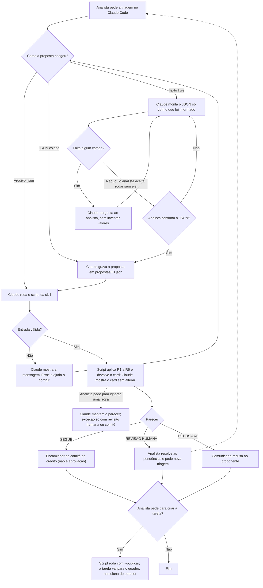

# Triagem de propostas - AgDev

[](https://github.com/victorsampaio/agdev-triagem-proposta/actions/workflows/testes.yml)

Skill do Claude (`triagem-proposta`) que faz a triagem de propostas de crédito para recuperação de pastagens degradadas. Ela recebe os dados de uma proposta, aplica as regras R1 a R6 e devolve um parecer (**SEGUE**, **RECUSADA** ou **REVISÃO HUMANA**) com todos os motivos e um card em Markdown pronto para virar tarefa.

Quem decide o parecer é o código, e não o modelo: o Claude conversa com o analista, roda o script e mostra o resultado sem alterá-lo.

> Os dados e as regras são fictícios e fazem parte de um teste prático. Não representam a política de crédito da AgDev.

## Rodar em 5 minutos

Pré-requisitos: [Python](https://www.python.org/downloads/) 3.10 ou superior e [Git](https://git-scm.com/downloads).

```bash
git clone https://github.com/victorsampaio/agdev-triagem-proposta.git
cd agdev-triagem-proposta
python -m triagem exemplos/P-004.json
```

O último comando já mostra o card da proposta P-004. O código das regras não tem dependências, então não é preciso instalar nada para usá-lo.

Para rodar os testes, instale o pytest num ambiente virtual:

```bash
python -m venv .venv
# Windows (PowerShell):
.venv\Scripts\Activate.ps1
# Linux/macOS:
source .venv/bin/activate

pip install -r requirements-dev.txt
pytest
```

No Windows, se `python` abrir a Microsoft Store ou disser que o Python não foi encontrado, instale o Python pelo site oficial marcando a opção "Add python.exe to PATH" e abra um terminal novo.

## Usar com o Claude Code

Pré-requisito: [Claude Code](https://www.anthropic.com/claude-code) instalado e com login feito.

A skill fica em `.claude/skills/triagem-proposta/`, e o Claude Code a reconhece automaticamente quando é aberto na pasta do projeto.

```bash
cd agdev-triagem-proposta
claude
```

Depois, é só pedir em português. Por exemplo:

- "Faça a triagem da proposta exemplos/P-004.json."
- "Qual o parecer desta proposta?" seguido do JSON colado.
- "Proposta P-010: 250 ha de pastagem degradada, matrícula de 900 ha, CAR de 910 ha, CAR ativo, CPF regular."

O Claude não decide o parecer: ele roda o script da skill, que aplica as regras por código, e mostra o card sem alterações. Quando os dados vêm em texto livre, ele monta o JSON, mostra para você e pede confirmação antes de rodar. Propostas coladas na conversa são gravadas em `propostas/<id>.json` (pasta ignorada pelo git) antes da triagem. Por isso, o Claude Code pede permissão para gravar esse arquivo e para rodar o `python`.

### Fluxo de uso



As instruções completas estão no [`SKILL.md`](.claude/skills/triagem-proposta/SKILL.md), e os testes feitos com o Claude Code estão registrados em [`docs/validacao-claude-code.md`](docs/validacao-claude-code.md).

A skill foi testada só no Claude Code. Para o Claude Desktop, a pasta da skill teria de ser compactada e enviada nas configurações do aplicativo, mas isso não foi testado.

## Como ler o parecer

| Parecer | O que significa | Próximo passo |
|---|---|---|
| **SEGUE** | A proposta atende às regras R1 a R6. Não é aprovação de crédito. | Encaminhar ao comitê de crédito. |
| **REVISÃO HUMANA** | Falta um dado, há uma divergência ou uma situação que pede análise. | Um analista resolve as pendências e roda a triagem de novo. |
| **RECUSADA** | A proposta descumpre uma regra eliminatória. | Comunicar a recusa ao proponente. |

Quando há motivos de recusa e de revisão ao mesmo tempo, vale RECUSADA, mas todos os motivos aparecem no card.

O card tem três partes:

- **Motivos:** as regras que a proposta não atendeu, com o resultado de cada uma.
- **Pendências:** as ações concretas para resolver cada motivo.
- **Versão das regras:** permite saber com que regra cada proposta foi avaliada.

## Regras

| Regra | Critério |
|---|---|
| R1 | Área de pastagem degradada de pelo menos 100 ha. Abaixo disso: RECUSADA. |
| R2 | Nenhum alerta de desmatamento depois de 01/01/2020. Com alerta: RECUSADA. |
| R3 | CAR "Ativo" segue. "Pendente": REVISÃO HUMANA. "Cancelado" ou "Suspenso": RECUSADA. Outro valor: REVISÃO HUMANA. |
| R4 | Situação cadastral do CPF ou CNPJ diferente de "Regular": REVISÃO HUMANA. |
| R5 | Diferença entre a área da matrícula e a área do CAR acima de 5% da área da matrícula: REVISÃO HUMANA. |
| R6 | Campo obrigatório ausente: REVISÃO HUMANA, dizendo qual campo falta. |

Resultados das propostas de exemplo (pasta `exemplos/`):

| Proposta | Parecer | Motivos |
|---|---|---|
| P-001 | SEGUE | Nenhum |
| P-002 | RECUSADA | R1: 60 ha, abaixo do mínimo de 100 ha |
| P-003 | REVISÃO HUMANA | R5: diferença de 100 ha (11,11% da matrícula) |
| P-004 | RECUSADA | R2: alerta em 15/03/2023; R3: CAR pendente |
| P-005 | REVISÃO HUMANA | R4: situação cadastral pendente; R6: falta a área da matrícula |

## Usar pela linha de comando

Na pasta do projeto:

```bash
python -m triagem exemplos/P-004.json                  # card em Markdown
python -m triagem exemplos/P-004.json --formato json   # parecer em JSON
python -m triagem exemplos/P-004.json --saida card.md  # grava o card em UTF-8
python -m triagem < exemplos/P-004.json                # lê a proposta da entrada padrão
```

No PowerShell, prefira `--saida` em vez de redirecionar com `>`, que grava em outra codificação e estraga os acentos.

Se o arquivo não existir, o JSON estiver quebrado ou não for um objeto, o comando mostra uma mensagem começando com `Erro:` e termina com código 2.

Card gerado para a proposta P-004:

```markdown
# Triagem P-004: RECUSADA

**Parecer:** RECUSADA

**Versão das regras:** 1.0.0

## Motivos

- **R2 (RECUSADA):** Alerta de desmatamento em 15/03/2023, posterior a 01/01/2020.
- **R3 (REVISÃO HUMANA):** Situação do CAR é "Pendente".

## Pendências

- [ ] Comunicar ao proponente a recusa: alerta de desmatamento posterior a 01/01/2020.
- [ ] Verificar com o proponente a regularização do CAR.

## Próximo passo

Comunicar a recusa ao proponente. A proposta não segue para o comitê.
```

## Criar a tarefa no quadro (integração simulada)

O enunciado não exige conexão com um sistema real. Por isso, a integração simula um gerenciador de tarefas numa pasta local:

```bash
python -m triagem exemplos/P-004.json --publicar
```

O comando mostra o card normalmente e cria a tarefa em `saida/tarefas/` (pasta ignorada pelo git):

- `P-004.md`: o card da proposta;
- `quadro.json`: a lista de tarefas, com coluna, parecer, versão das regras e data;
- `quadro.md`: o quadro para leitura, com as colunas **Comitê de crédito** (SEGUE), **Revisão humana** e **Recusadas**.

Se a mesma proposta for triada de novo, por exemplo depois de resolver as pendências, a tarefa é atualizada e muda de coluna, sem duplicar. Para usar outra pasta, acrescente `--quadro outra/pasta`.

No Claude Code, basta pedir "crie a tarefa" depois da triagem. O Claude só publica quando o analista pede.

Para ligar a um gerenciador real (Asana, Trello, TickTick), basta escrever outra classe com o mesmo método `publicar` de `triagem/tarefas.py`. As regras não mudam.

## Premissas e decisões

O enunciado deixa alguns pontos em aberto. As dúvidas foram enviadas à AgDev por e-mail, e as respostas de 13/10/2026 estão marcadas abaixo. Cada decisão tem um teste automatizado que a comprova.

**Mudança de regra:** a AgDev informou que a data de corte da R2 é **01/01/2020**, e não 01/01/2021 como estava no enunciado.

| Regra | Decisão | Origem |
|---|---|---|
| R1 | Exatamente 100 ha passa. Área negativa ou que não seja número vai para revisão humana. | Enunciado e premissa |
| Áreas | As áreas devem vir como número (`850`). Área enviada como texto (`"850"`) é considerada inválida e vai para revisão humana. | Premissa |
| R2 | Alerta depois de 01/01/2020 recusa. Alerta no próprio dia 01/01/2020 não recusa. | Confirmado pela AgDev |
| R2 | O campo aceita nulo (sem alerta), uma data ou uma lista de datas. Lista vazia é sem alerta. Basta um alerta depois do corte para recusar. | Confirmado pela AgDev |
| R2 | Datas aceitas nos formatos `AAAA-MM-DD` e `DD/MM/AAAA`. Data inválida vai para revisão humana. | Premissa |
| R3 | Maiúsculas, minúsculas e espaços são ignorados. Valor fora da lista vai para revisão humana, citando o valor recebido. | Confirmado pela AgDev |
| R4 | Só "Regular" passa, inclusive para CNPJ. O tratamento dos status de CNPJ com dados reais está no `DESIGN.md`. | Confirmado pela AgDev |
| R5 | Diferença de exatamente 5% passa. A diferença é absoluta (CAR maior ou menor) e calculada sobre a área da matrícula, com números decimais exatos. | Enunciado e premissa |
| R5 | Sem a área da matrícula, a R5 não é avaliada e vira pendência. Matrícula igual a zero vai para revisão humana. | Premissa |
| R6 | Os 7 campos do formato sugerido são obrigatórios. | Confirmado pela AgDev |
| R6 | `alerta_desmatamento: null` significa sem alerta. Campo ausente vai para revisão humana. Nos demais campos, `null` conta como ausente. | Confirmado pela AgDev (nulo em outros campos: premissa) |
| Card | Motivos são as regras que falharam. Pendências são as ações concretas para resolver. Proposta com SEGUE não tem pendências. | Confirmado pela AgDev |
| Escopo | A skill aplica somente R1 a R6 e avalia uma proposta por vez. | Enunciado |

## Estrutura do projeto

```text
.claude/skills/triagem-proposta/
    SKILL.md            instruções da skill para o Claude
    scripts/triagem.py  script que a skill roda
triagem/
    regras.py           parâmetros e regras R1 a R6
    parecer.py          consolidação do parecer
    card.py             card em Markdown
    tarefas.py          quadro de tarefas simulado
    __main__.py         linha de comando (python -m triagem)
tests/                  testes automatizados (pytest)
exemplos/               propostas P-001 a P-005
docs/                   validação no Claude Code e registro de uso de IA
DESIGN.md               desenho da solução e decisões de processo
PERGUNTAS.md            respostas às perguntas técnicas
CHANGELOG.md            histórico de versões das regras
```
